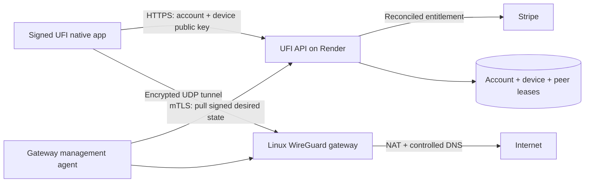

# UFI VPN service: deployment proposal

Historical proposal. The approved Hetzner gateway and native client implementation are described in [Managed VPN launch](managed-vpn-launch-plan.md), which supersedes the hosting and launch assumptions below.

Prepared 2026-10-01; membership launch updated 2026-10-03. This is an engineering proposal, not an operating VPN or a claim that gateways or native apps have been deployed. **UFI Vault at $3.94 USD/month** now supports membership checkout for encrypted Passwords, Documents and Keys. UFI-supplied VPN access is included when service setup is complete, with intended automatic selection of a nearby available region and one Connect/Disconnect control after device setup. The owner will set up the hosting account; the website explicitly shows VPN setup pending. Existing owners retain access to read, recover, export and delete their encrypted data. Saved country labels and links to another provider do not fulfill the VPN product.

## Hosting recommendation and pilot budget

Start with **DigitalOcean Linux Droplets**, one in San Francisco (`sfo3`) and one in Frankfurt (`fra1`), subject to account/region availability. Use the 2 GiB Basic plan for a small invited pilot. This gives a straightforward US/European deployment without depending on an unavailable lowest-cost offer. This recommendation is an engineering judgment, not a throughput benchmark or a commercial VPN hosting approval.

| Option | Published small-instance price | Transfer and regions | Assessment |
| --- | --- | --- | --- |
| DigitalOcean Basic | $6/month: 1 GiB, 1 vCPU, 25 GiB disk; $12/month: 2 GiB, 1 vCPU, 50 GiB disk | 1,000/2,000 GiB outbound respectively; inbound free, additional outbound $0.01/GiB, allowances pooled across a team. US, Europe, Canada, Singapore, India and Australia options. | Recommended $12 instance for each pilot region; validate the required plan in the chosen region before purchase. |
| Hetzner CX23, Europe | $6.49/month excluding IPv4 and tax under the published June 2026 price schedule | 20 TB included EU transfer. Cost-optimized locations include Germany/Finland; Hetzner also operates US and Singapore regions with different products/prices. | Potential later European cost optimization. The public cost-optimized page currently marks CX23 unavailable; do not budget an available deployment at this price until the console confirms stock and IPv4 total. |

Sources checked on the date above: [DigitalOcean pricing](https://www.digitalocean.com/pricing/droplets), [transfer billing](https://docs.digitalocean.com/platform/billing/bandwidth/), [region availability](https://docs.digitalocean.com/platform/regional-availability/), [Hetzner current price schedule](https://docs.hetzner.com/general/infrastructure-and-availability/price-adjustment/), [cost-optimized availability/transfer](https://www.hetzner.com/cloud/cost-optimized/), [Hetzner locations](https://www.hetzner.com/cloud/).

Two recommended gateways cost **$24/month base** and provide 4,000 GiB of pooled monthly outbound allowance when kept for the full month. This excludes tax, extra transfer, control-plane costs, DNS, signing/store accounts, monitoring, support and engineering. Another 1,000 GiB beyond the included allowance costs $10 at the stated rate. At $3.94/month, seven members cover only the $24 base before payment fees and every other expense. This is not a profitability forecast.

Begin with at most ten invited test accounts and two enrolled devices each; this is a rollout limit, not tested capacity. Measure throughput, packet loss, CPU, simultaneous tunnels, region latency and transfer consumption before raising it. Do not advertise unlimited bandwidth or 10,000 VPN users. The application's video-viewer target does not establish VPN capacity. Define a disclosed fair-use/transfer policy and an operating budget before paid launch. Provider billing alerts are not hard spending caps; use aggregate gateway transfer monitoring, admission limits and an explicit budget-response policy. Per-account byte quotas would require additional disclosed counters, separate from timestamp-only activity.

## Could Proton provide UFI's VPN infrastructure?

Potentially through an expressly authorized commercial arrangement; an existing personal subscription is insufficient. Proton's current terms, section 2(6)-(7), restrict account sharing and resale, sublicensing or third-party access unless the plan expressly permits it or Proton gives written authorization. Obtain written permission covering UFI's paying customers and branding before treating Proton as the service behind the $3.94 subscription. [Proton terms](https://proton.me/legal/terms).

Proton documents dedicated gateways for organizations and downloadable WireGuard/OpenVPN configurations. Those are relevant technical capabilities, but they do not establish a public white-label provisioning API or permission to resell organization seats to UFI customers. [Organization gateway documentation](https://protonvpn.com/support/add-gateway-organization/).

A partnership proposal would need to confirm customer provisioning and revocation, permitted native-client integration, available countries, capacity, privacy responsibilities, support and the actual commercial price. UFI would still need paid-entitlement enforcement and installed native clients for its one-button experience; the browser cannot start the tunnel by itself. Compare the agreed per-user/gateway costs, fees and operating expenses against $3.94/month before offering that price. No suitable agreement, white-label API or viable unit economics has been confirmed, and no contact, purchase or account sharing has been performed. Until then, Proton remains an existing-provider option for users who connect through their own authorized apps and accounts.

## Keep the website and tunnels separate

Keep the authenticated HTTPS account, billing and provisioning API on Render. Run WireGuard gateways on dedicated Linux VMs with public addresses, UDP access and privileged network administration. Render's documented public ingress forwards to one HTTP port, while WireGuard sends its packets over UDP. Therefore the existing Render web service is not a supported public WireGuard gateway; changing its Dockerfile does not supply the missing ingress. [Render ingress](https://render.com/docs/web-services#port-binding), [WireGuard protocol](https://www.wireguard.com/protocol/).

The gateway uses NAT through its own public address rather than emitting packets with arbitrary public source addresses. DigitalOcean documents network anti-spoofing restrictions and a maximum network rate that is not guaranteed application throughput. Its WireGuard guide describes the relevant Linux tunnel/NAT pattern. Confirm commercial VPN use, abuse handling and relevant regional restrictions with the selected provider before paid operation. [Droplet limits](https://docs.digitalocean.com/products/droplets/details/limits/), [provider WireGuard guide](https://www.digitalocean.com/community/tutorials/how-to-set-up-wireguard-on-ubuntu-22-04).

## Provisioning and paid access

The following endpoints and state are proposed, not implemented:

1. Native app signs in through the system browser with authorization-code/PKCE and a verified app/universal-link return. Payment completes on the existing authorized checkout flow. A success URL alone never grants VPN access.
2. The app creates its own WireGuard key pair using maintained native libraries. Only the public key is registered through authenticated `POST /vpn/devices`; private keys never enter UFI API requests, browser storage, analytics, support diagnostics or generated server-side configuration downloads.
3. `POST /vpn/leases` verifies the current account, registered device ownership, unique valid public key, device limit, server-reconciled VPN entitlement and selected gateway capacity. Main membership/Resume Builder entitlements remain independent. Reject unpaid, expired, canceled or ambiguous subscriptions. A scheduled cancellation may keep access only until the paid period ends.
4. Persist the minimum account-to-device/public-key mapping, gateway assignment, unique tunnel address and lease expiry needed for authorization and revocation. Allocate tunnel addresses transactionally. Never accept client-supplied server commands, routes, interface names, private-network targets or arbitrary gateway URLs.
5. A narrowly privileged gateway agent pulls authenticated, signed desired state with mTLS. It applies structured peer updates through fixed OS APIs without shell interpolation. Management interfaces are not open to VPN customers or the public internet. The app receives the gateway public key, endpoint, assigned tunnel address, DNS settings and lease expiry; it already has its private key.
6. Native connection status becomes Connected only after a working tunnel and a successful UFI health check through it. A paid flag, downloaded config or clicked button is insufficient. Failures keep a usable disconnect path and a clear status.

WireGuard does **not** enforce Stripe expiry or application JWT expiry. The gateway must remove the peer on revocation or expiry, even if a client keeps reconnecting with an old configuration. Use short signed leases, for example five minutes, bounded by the paid-through time; renew only while entitlement remains valid. Deliver cancellation/deletion revocations promptly, reconcile periodically, and enforce expiry locally during API outages. A gateway watchdog must close expired access if the management agent fails. Reboot starts without stale peers and restores only unexpired, authenticated desired state. Test this behavior before collecting payment.

If the earlier label-only product has any subscribers, reconcile their actual purchases before migrating billing. Do not silently change what an existing subscription buys or charge for an unavailable VPN. The configured $3.94 Stripe price alone is not proof of service readiness.

## Nearby-region selection without storing a user's IP history

Use the request address only at the trusted HTTPS ingress, following the verified proxy chain; never trust an arbitrary forwarded-IP header or client-supplied location. Look up a coarse area against a locally installed, licensed IP-geolocation database in memory, select a small list of healthy regions, and immediately discard the address and lookup coordinates. Do not place either in URLs, persistent caches, traces, errors, analytics, learning systems or application logs.

IP location is approximate and may reflect an existing VPN or carrier gateway. Offer a manual country choice. The native client may compare short connection probes to the candidate UFI gateways and choose the lowest-latency healthy one; this is more useful than claiming the IP's country is the user's actual location. Use manual selection when lookup fails. Advertise only regions that have deployed, healthy gateways. GeoLite requires an account/license key and attribution; its free city data is less accurate than the paid product. Review the license for the intended deployment. [MaxMind database guidance](https://dev.maxmind.com/geoip/geolite2-free-geolocation-data/), [external-use attribution](https://support.maxmind.com/knowledge-base/articles/sell-or-display-data-from-geolite-databases-and-web-services).

This policy concerns persistence: the gateway must see a peer's current network endpoint in runtime memory to exchange packets, and hosting/edge providers process connection metadata. Disable access/flow/DNS-query logging where supported and inspect provider retention before publishing a no-IP-history claim. Keep public API/gateway endpoints free of third-party tracking.

## Native client requirements

A browser/PWA cannot create an operating-system WireGuard tunnel. A one-button experience requires an installed UFI native component and the first-use operating-system consent. Opening Windows VPN settings or another provider's app is not a UFI tunnel.

| Platform | Concrete implementation path | First-use requirement |
| --- | --- | --- |
| Windows | Signed app plus a narrowly scoped Windows service using WireGuard's embeddable service; protect keys with OS-bound storage and authenticated IPC. | Signed installer and administrator-approved service installation; then Connect/Disconnect in UFI. |
| Linux | Packaged app using NetworkManager's WireGuard D-Bus APIs with narrow polkit authorization, or a reviewed limited helper. | Install package and approve required networking privilege. |
| iOS/iPadOS | Native app with WireGuardKit and a Network Extension packet-tunnel provider; use protected Keychain storage. | Apple organization developer account, provisioning/signing with Network Extension capability, reviewed VPN disclosures and system VPN consent. |
| Android | Native service using the WireGuard tunnel library and Android `VpnService`, with protected local key storage and required foreground lifecycle. | System consent from `VpnService.prepare()`; only one VPN service can be active per user/profile. |

[WireGuard embedding options](https://www.wireguard.com/embedding/), [Apple packet tunnel API](https://developer.apple.com/documentation/networkextension/nepackettunnelprovider), [Network Extension entitlement](https://developer.apple.com/documentation/bundleresources/entitlements/com.apple.developer.networking.networkextension), [Apple VPN app requirements, section 5.4](https://developer.apple.com/app-store/review/guidelines/#vpn-apps), [Android VPN lifecycle and consent](https://developer.android.com/develop/connectivity/vpn).

The existing Expo/web wrapper needs native extension/service work; a web-only deployment cannot add these capabilities. Existing official WireGuard apps can support an explicitly labeled manual pilot after secure provisioning is built, but do not satisfy the requested integrated one-button UX. Native subscription purchase/link behavior must be reviewed for each distribution platform and region before store submission. Do not assume the website's Stripe link can simply be copied into every native storefront.

## Security and operational boundaries

- Generate one key per device; require reauthentication to enroll/revoke a device. Wrap at-rest key material with platform-protected keys where available. Imported/exportable WireGuard profiles can be copied: never advertise them as clone-proof. Hardware-backed signing for device enrollment is separate from the WireGuard key and does not make an exportable tunnel key nonexportable.
- Use authenticated, expiring, single-use provisioning requests bound to the account, device and operation. WireGuard already has authenticated replay protection; timestamps displayed in the UI are not authentication or cloning protection. [Protocol design](https://www.wireguard.com/protocol/).
- Isolate peers from one another and from infrastructure private networks/metadata endpoints. Permit only the approved internet egress policy, restrict management access, keep DNS resolution inside the tunnel, and route or block IPv6 explicitly. Test DNS/IPv6 leaks, Wi-Fi/cellular changes, sleep/resume, crashes and kill-switch behavior on each platform.
- Separate billing/device authorization records from connection history. Keep the visible activity list to connect/disconnect plus timestamps, local and bounded. Aggregate gateway health/transfer counters may support operations without per-user destination, DNS or browsing records. Do not send VPN data to advertising, monetization or deep-learning features.
- Monitor gateway availability, aggregate throughput/transfer, CPU, lease-reconciliation lag and certificate expiry. Use security updates, reproducible versioned gateway images, controlled rollout, a tested key-rotation/revocation process and an incident contact. Encrypt backups of necessary control-plane records; avoid packet captures, peer endpoint dumps and credentials in logs/backups.
- Country switching obtains a fresh authorized lease, keeps the client's kill switch active during transition, confirms the new tunnel, then revokes the previous peer. Do not infer a changed public country from a dropdown alone. Define behavior when the target region is full or unhealthy.

## Accounts and release gates still required

Before resource creation: select the hosting account, approve the pilot regions and monthly budget, provide a scoped infrastructure token through the deployment secret store, and configure admin SSH/public keys and VPN DNS records. No keys or passwords should be pasted into chat. No paid resources have been created by this proposal.

Before native distribution: obtain the Apple organization developer/signing account, Android Play/signing access, Windows signing/distribution credentials and Linux package-signing process. Obtain the geolocation database account/license and secure its update credential. Create gateway management certificates/signing keys in the appropriate secret stores. Existing Stripe credentials are reused only after billing/product readiness is verified. A personal Proton subscription is not UFI infrastructure or a resale authorization.

Before enabling UFI VPN connections for members: deploy real gateways and paid provisioning, ship functional supported clients, prove cancellation/expiry/device revocation across outages, verify DNS/IPv6 and kill-switch behavior on real devices, measure pilot capacity and costs, publish the actual regions and usage terms, and ensure the observed service/privacy behavior matches the UI. Vault checkout depends on a valid active $3.94 monthly Stripe price and operational billing; it does not establish VPN readiness. Security is implemented and tested in specific controls; do not label this plan or the unfinished service “maximum security.”
