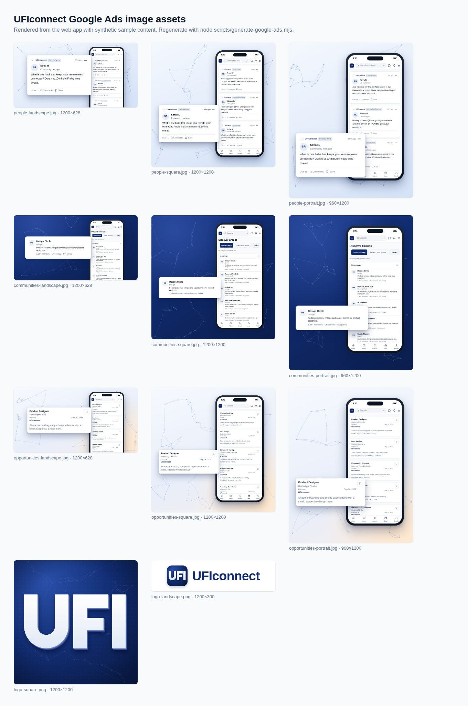

# Google Ads

Ads that promote UFIconnect on Google so new people find
https://uficonnect.org/. The product itself stays ad-free; nothing here adds
advertising to the app.



## Contents

| Path | What it holds |
| --- | --- |
| `campaign.mjs` | All ad text: search ad groups, keywords, sitelinks, callouts, snippets and display text |
| `images/` | Nine marketing images (three themes × landscape 1200×628, square 1200×1200, portrait 960×1200) and two logos (1200×1200, 1200×300) |
| `ufi-icon-3d.svg` | Source for the logos' 3D UFI icon: vector letters that need no font, filling a navy tile with a dot grid and network pattern |
| `google-ads-editor/1-…7-*.csv` | Search campaign for Google Ads Editor. It imports **paused** |
| `google-ads-editor/display-and-pmax-assets.csv` | Text and image checklist for responsive display, Demand Gen and Performance Max |
| `preview.jpg` | Contact sheet of every image |

Image themes: **people** (member feed), **communities** (group directory) and
**opportunities** (jobs). Each pairs the phone screen with one detail from it.

## Regenerate

Install dependencies with `npm ci`, `npm ci --prefix backend` and
`npm ci --prefix web`, then:

```sh
node scripts/generate-google-ads.mjs             # screens, images, CSVs, preview
node scripts/generate-google-ads.mjs --copy-only # text limits and CSVs only
node scripts/generate-google-ads.mjs --check     # verify committed output
```

Set `CHROMIUM_PATH` to use a preinstalled Chromium. The script signs in to the
real web UI through the audit harness and serves synthetic posts, groups and
jobs, so no production API or member data is involved. It fails if any text
exceeds Google's limits or an image has the wrong size or exceeds 5,120 KB.
Edit `campaign.mjs`, never the CSVs.

## Launch

**Search.** In Google Ads Editor choose *Account → Import → From file* and
import `1-campaign.csv` through `7-structured-snippets.csv` in order. The
campaign arrives paused at a $10 daily budget with Maximize clicks. Set
locations, budget and schedule, review, then post and enable. Add
`*-square.jpg` and `*-landscape.jpg` as campaign image assets.

**Display or Demand Gen.** Create a responsive display ad (or a Demand Gen image
ad) with the nine marketing images, both logos and the text from
`display-and-pmax-assets.csv`. Use final URL `https://uficonnect.org/` and the
*Sign up* call to action.

**Performance Max** optimizes toward conversions. Hold it until a reviewed
conversion signal exists (see below). The same assets fit an asset group.

## Measurement and privacy

No Google Ads conversion tag, remarketing tag or customer list is installed,
on purpose. App pages block Google scripts through CSP, Google Analytics runs
only after consent in an isolated iframe with advertising features off, and the
privacy policy says member data is not used for advertising
([details](../../docs/GOOGLE-ANALYTICS.md)). Adding any of these changes those
commitments and needs a privacy and security review first.

Until then, bid for clicks rather than conversions, and judge results by
comparing Google Ads clicks and spend with the first-party aggregate counts in
Office analytics for the same dates. Campaign query parameters are deliberately
kept out of analytics reports, so UTM tags will not appear there.

## Content rules

- Images show the real interface with fictional sample people, groups and
  employers. Do not swap in production screenshots with member data or
  third-party posts.
- Keep third-party names and logos out of ad text and images (Google's
  trademark policy). The feed's source bar is scrolled out of frame for this reason.
- Keep marketing images free of overlaid ad text; Google renders the headlines.
- Every claim must stay true on the public site: free to join, no ads in the
  feed, 80+ communities, 30+ live sources, browsing without an account. The
  script checks lengths, not accuracy.
- Final URLs point to public pages. Member-only pages such as `/groups` would
  send new visitors to sign-in.
- Ads promoting jobs fall under Google's employment-ad rules in the US and
  Canada. Do not target them by age, gender, parental status, marital status or
  ZIP code.
- Job dates in the images reflect the render date. Regenerate when they look stale.
